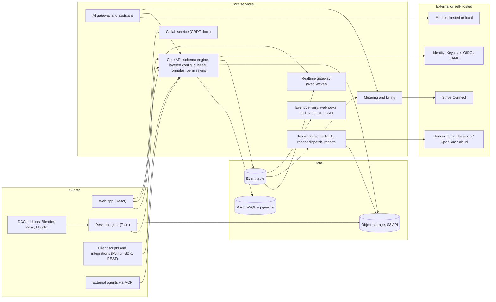
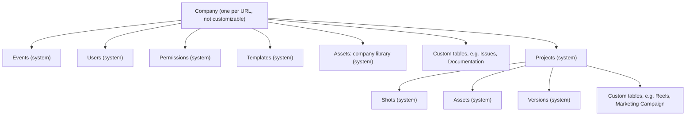
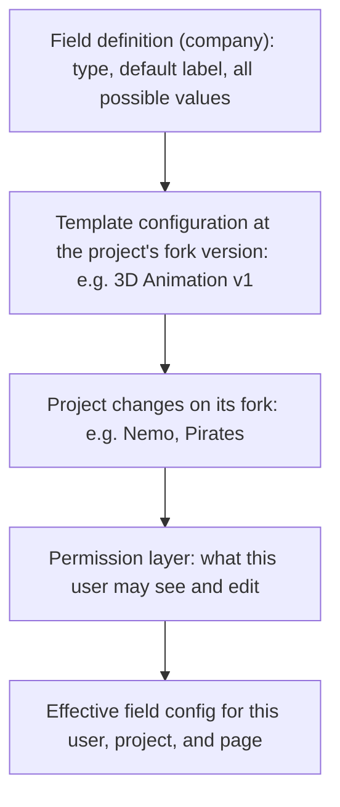
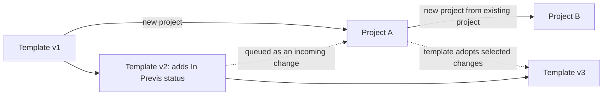
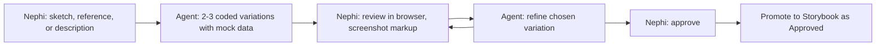

# SGPipeline architecture (brainstorm)

Status: preliminary. This is a working document for brainstorming with agents and people. Every recommendation here is a starting position, not a decision. Decisions get recorded in the Decision log at the bottom.

Companions: [product_master_plan.md](product_master_plan.md) (vision) and [Expectations_Fundamentals.md](Expectations_Fundamentals.md) (foundational requirements for the hierarchy, configuration, navigation, events, production management, and page types).

## 1. Constraints that drive the architecture

Any technology choice has to satisfy all of these.

From the master plan:

1. **Cloud and on-prem from one codebase.** The hosted product and a licensed install behind a studio firewall (including air-gapped "secret project" installs) run the same software. No cloud-only managed service can sit in the critical path unless it has a self-hosted equivalent.
2. **Cheap to run, free to start.** Pricing is usage-based with a thin markup, so infrastructure cost per user must be low and measurable. Every billable thing (storage, AI, compute, admin seats) must be metered from day one.
3. **Platform over hard-coded logic.** Users define their own tables, fields, pipeline types, and statuses. The starter templates are built with the same tools users have, not special code.
4. **Normalized data.** Even complex pipelines should read as a clean relational model.
5. **Huge files, latest-file truth.** Multi-gigabyte publishes, image sequences, caches. Fast "load the latest approved inputs for this shot."
6. **Frame-accurate review.** Stop on a frame, draw, note, compare versions.
7. **DCC integration.** Blender first, then Maya, Houdini, and others. Pipeline TDs write Python.
8. **Permissions with hard rules.** Customizable permission sets, project membership, field-level visibility, sandbox privacy, and rules like "no self-approval" that the AI cannot get around either.
9. **AI everywhere, but optional and swappable.** Hosted models in the cloud, local models on-prem, and a company-level switch for "no data leaves the building."
10. **Payments.** Work-for-hire payouts through the app with a small processing fee.
11. **Design-driven.** UI comes from an approved component library (see section 11).

From the fundamentals:

12. **A fixed hierarchy with flexible contents.** Company > Projects is fixed. System tables and client-created custom tables live at either level (section 4.1).
13. **Layered configuration.** The same table (for example Shots) behaves differently per project: different status values, hidden fields, labels. Visibility resolves through the project's template, the project's own changes, and permissions (section 4.4). Templates work like git: every project is a branch that evolves freely, accepts template changes only one at a time when it wants them, and can contribute its changes back (section 4.9).
14. **Pages are data.** Navigation is a tree of client-created Saved Pages and folders whose placement follows each page's query (section 5).
15. **Calculated fields and conditional formatting** are part of the platform, not plug-ins (section 4.6).
16. **The Event table records everything** and is a public integration surface that clients build business processes on (section 4.8).
17. **Production management is first-class.** Bids, budgets, schedules, and reports for producers, accountants, executives, and funders, alongside artist-centric pipelines (section 6).

## 2. System overview



Guiding idea: a small number of boring, self-hostable building blocks (Postgres, S3-compatible storage, containers, OIDC). Everything clever lives in our code, where it can run in both deployment modes.

**One API for everyone.** The web app, desktop agent, DCC add-ons, AI assistant, and client scripts all use the same public API. There are no private endpoints for our own UI, so anything the UI can do, a client integration can do too, under the same permissions.

## 3. Preliminary tech stack

| Layer | Preliminary pick | Main alternative |
| --- | --- | --- |
| Web frontend | React + TypeScript, Vite single-page app | Next.js |
| UI primitives | Radix primitives, Tailwind, design tokens as CSS variables (shadcn/ui as owned starting code) | Mantine, MUI |
| Component library | Storybook as the approved design library | decided |
| Data grid (table pages) | AG Grid or TanStack Table + TanStack Virtual (prototype both, then decide) | Glide Data Grid |
| Charts (dashboard widgets) | Apache ECharts to start, themed from our tokens and wrapped behind our own widget components so it can be replaced | Our own chart components, if ECharts can't be made to match the design system |
| Dashboard layout | CSS grid driven by the page's row/column configuration | react-grid-layout |
| Core API | Python, FastAPI, SQLAlchemy Core, Pydantic | decided |
| Formulas and conditional formatting | Visual builders in the UI (no syntax to type); stored as structured expression trees (JSON) and compiled to SQL in Python | decided |
| Database | PostgreSQL (with pgvector, full-text search, table partitioning for events) | none seriously considered |
| Object storage | S3 API: AWS S3 / Cloudflare R2 in cloud; Ceph RGW, SeaweedFS, or MinIO on-prem. Cheaper cold tiers for archived projects and event exports | Studio NAS via storage roots |
| Jobs / queue | Postgres-backed queue to start | Temporal, NATS JetStream |
| Realtime | WebSockets fed by the Event table (Postgres LISTEN/NOTIFY first) | NATS |
| Event delivery | Event cursor API plus signed webhooks with retries | Kafka-compatible stream for large studios |
| Reports and exports | CSV and XLSX exports; PDF reports rendered from HTML (for example WeasyPrint) | Headless browser rendering |
| Collaborative docs | Yjs (CRDT) for script and world bible | Automerge |
| Identity | Keycloak everywhere (self-hostable, OIDC/SAML, LDAP/AD federation) | decided |
| Desktop agent | Tauri (Rust core, web UI) | Electron |
| DCC integrations | Python packages per DCC on a shared pipeline-core library | none |
| Media processing | FFmpeg workers, OpenColorIO, OpenImageIO | none |
| Review playback (web) | WebCodecs on frame-indexed proxies, canvas overlay for markup | Image-sequence playback |
| Review playback (desktop) | Open RV integration for high-end review | none |
| Editorial interchange | OpenTimelineIO | none |
| Scene / asset interchange | OpenUSD; OpenAssetIO for asset resolution in DCCs (shot assembly approach deferred: see Open questions) | Native .blend linking |
| Render dispatch | Flamenco as the default, ready-made integration; any other farm via a published render-job format and adapter API ("bring your own"); a growing library of ready-to-go adapters (OpenCue, Deadline, cloud GPU services) | decided |
| AI gateway | Provider-agnostic gateway (LiteLLM or our own thin layer) with per-company provider switches and an "Auto" router | Direct provider SDKs |
| Image / visual generation | Hosted image models plus ComfyUI workflows for local or on-prem | Provider-only |
| Agent tool access | MCP server over the Core API | Custom tool protocol |
| Metering / billing | Usage events in Postgres, billed through Stripe; Lago or OpenMeter if needed | Stripe-only |
| Payouts | Stripe Connect | Adyen for Platforms |
| Deployment | Containers; Helm chart for Kubernetes; Docker Compose for small installs | Nomad |
| Cloud provider | AWS to start, kept portable through S3/Postgres/OIDC | GCP |

### Why these picks

**Python for the Core API.** Pipeline TDs, DCC scripting, and most AI tooling are Python. One language for the server, the public SDK, and the DCC add-ons means shared models, shared validation, and one hiring profile. That also matches how the Shotgun-era community already works. The TypeScript client for the web app is generated from the OpenAPI spec, so the frontend stays type-safe.

**Postgres for everything it can do.** Relational data, custom schemas, formulas compiled to SQL, full-text search, vector search for AI retrieval, the Event table, and the job queue at the start. Fewer moving parts means cheaper hosting and easier on-prem installs. Add specialized systems only when measurements say so.

**SPA instead of Next.js.** The product is an application, not a content site. A static SPA served by the API is trivial to ship inside an on-prem install. The marketing site can be separate.

**ECharts to start, our own charts if needed.** ECharts covers every chart type in the fundamentals (pie, heat map, histogram, bar), handles large data sets, is Apache-licensed, and is configured from plain data, which matters because a dashboard widget is a stored record. Every UI element must look harmonized, so ECharts is themed from our design tokens and hidden behind our own widget components. If it can't be made to match, we replace the renderer without touching stored widgets or pages.

**Formulas without syntax.** Users build calculated fields and conditional formatting with visual tools: pick fields, operations, functions, and linked tables. Nobody types a formula. Behind the UI, each formula is stored as a structured expression tree (JSON), which the server type-checks and compiles to SQL, so sorting, filtering, grouping, and dashboards work on calculated values exactly as on stored ones. The browser never re-implements the logic.

**Tauri desktop agent.** It does what Shotgun Desktop / Toolkit did: sign in once, sync and cache files, map storage paths per OS, launch DCCs with the right context, and resolve "latest approved" for a shot. Tauri is far lighter than Electron, which matters for artists running heavy DCCs.

**Open standards in the asset layer.** OpenUSD, OpenTimelineIO, OpenColorIO, OpenAssetIO, Open RV, and OpenCue are Academy Software Foundation or industry standards. Adopting them makes studios trust the platform and keeps the indie path tool-agnostic.

**License checks before committing.** MinIO's community edition has changed terms, tldraw needs a commercial license for production, and AG Grid's best features are in its paid Enterprise edition. Check each before relying on it.

## 4. The platform core

This is the heart of SGPipeline and the part most worth getting right early.

### 4.1 Hierarchy and scope



- **Company** is the tenant. One company per URL, and the only table clients cannot customize. In architecture terms, a company is a site: its own Postgres schema (or its own database for larger customers).
- **Every table has a scope:** company-level or project-level. Project-level tables carry a required project link. Company-level tables do not.
- **System tables** (Projects, Users, Permissions, Templates, Events, Shots, Assets, Versions, and supporting tables such as Sequences, Tasks, Notes, Pipeline Steps) ship with the product because built-in features depend on them. The review player depends on Versions, for example. Clients can relabel them, hide them per project, and add fields to them, but cannot delete them.
- **Custom tables** are created by clients at either level and behave exactly like system tables in pages, permissions, formulas, events, and the API.
- **Assets at both levels.** Decided: one Asset table where the project link is optional. Assets without a project form the company library (for example recurring characters), and project assets belong to one project. Shots in any project can link to library assets. This keeps one normalized table instead of two near-duplicates.

### 4.2 Schema as data

A metadata catalog describes each company's world:

- **Table** — code, display name, scope (company or project), system or custom, icon.
- **Field** — typed: text, number, currency, percent, date, duration, checkbox, list (dropdown), status, entity link, multi-entity link, user, media, file/publish, URL, color, calculated, and summary (roll-up across linked records).
- **Link** — relationships between tables, including many-to-many, with the reverse side visible from both tables.
- **Status values, pipeline steps, templates, template versions, pages, folders, permission sets** — also rows in the catalog, not code.

### 4.3 Real tables, not a key-value blob

Decided: when a client adds a table or field, the platform generates real Postgres tables and columns (with foreign keys and join tables for many-to-many links) through controlled, transactional DDL. One JSONB column per table holds integration metadata. Clients get normalized data, real indexes, and fast queries.

Physical columns are company-wide. A field exists once on the Shots table, whether or not a given project shows it. Per-project differences are configuration (section 4.4), never separate columns or tables.

### 4.4 Layered configuration

The same field can look and behave differently per project. In project "Nemo" the Shot Status field offers seven values; in project "Pirates" it offers three. Configuration resolves in layers, each one able to override the one above:



Each layer can set:

- **visible / hidden** for the table or field
- **display label** (Shots can be called "Panels" in a manga project)
- **valid values** for list and status fields, with their order
- **default value**
- **required / optional**
- **editable / read-only**

Rules:

- The permission layer can only restrict, never widen, what the project layer allows.
- Hidden fields keep their data. Hiding a field in one project never deletes values.
- The API returns the effective configuration alongside data, so every client (web, desktop, scripts, AI) renders the same thing.
- The schema API exposes all layers, so admin tools and integrations can inspect why a field is hidden.

### 4.5 Status values, colors, and icons

- **Status values are rows** in a company-level table: code, display name, color, icon. Clients rename them, recolor them, and add new ones freely.
- **Each status field has a valid-values list per layer.** "Nemo" uses Not Ready, Ready to Start, In Story, In Layout, In Animation, In Comp/Light, Final. "Pirates" uses Ready to Start, In Progress, Final Render Complete. Both use the same system Status field on the Shots table.
- **Colors and icons are client data,** not design tokens. The design system supplies a default palette and guarantees that any client-chosen color stays legible (automatic text contrast on colored backgrounds).
- **Meaning stays configurable.** A status value can optionally be tagged with a platform meaning (for example "counts as complete", "blocks downstream", "approved"), so platform features like progress reports and render dispatch understand client-invented statuses without hard-coding names.

### 4.6 Calculated fields, summaries, and conditional formatting

Decided: no formula syntax for users. All three are built with visual tools in the UI: choose fields (including fields on linked records), operations, functions, and conditions from menus, with a live preview against real records. Under the hood they share one structured expression format that is safe to evaluate on the server.

Examples, described the way the builder would show them:

- **Calculated fields** reference fields on the same record and on linked records:
  - Animation due = Shot due date minus 4 weeks
  - Total budget = Labor plus Equipment plus Contingency
- **Summary fields** aggregate across linked records:
  - Total bid = (sum of Sub-bid amounts) times Markup
  - Percent complete = (count of Tasks whose status means "complete") divided by (count of Tasks)
- **Conditional formatting** is a list of rules on a page or field: a condition and a style (row or cell background, text color, icon, bold). For example: if Due date is before today and Status does not mean complete, the row background is red.

Implementation:

- Each formula is stored as a structured expression tree (JSON), never as text. The tree is type-checked against the schema and compiled to SQL (expressions on the same row, joins for linked fields, subqueries for summaries).
- The same tree format is available through the API, so scripts and the AI assistant can create formulas without a text syntax either.
- The AI assistant can propose a formula from a plain-language request ("animation is due four weeks before the shot") and show it in the builder for the user to confirm.
- Because they compile to SQL, calculated values sort, filter, group, and chart like stored values.
- Expressions that become too slow can be **materialized**: stored in a real column and recomputed by a worker when the Event table reports a change to any input.
- Conditional formatting results come back with the query as per-row style flags, so every client renders identical formatting.
- Changing a formula is itself an event, so reports can explain why numbers changed.

### 4.7 Query API

A Shotgun-style query interface: table, filters (including through links, such as "shots whose sequence status is In Progress"), fields to return (including calculated and summary fields), sorting, grouping with summaries per group, and pagination. Exposed as REST + OpenAPI first, with a Python SDK. GraphQL can be added later.

- The engine compiles queries to SQL and applies permissions and layered configuration inside the query, not after.
- Batch operations (create, update, delete many records in one transaction) for pipeline scripts.
- Script users: API keys that belong to a named integration with its own permission set, so automations are auditable and revocable.
- Versioned API with a deprecation policy, because studios build years of tooling on it.

### 4.8 The Event table

The fundamentals say clients rely on the Event table to trigger their own processes, so it is a product surface, not just an audit log.

What it records:

- Every create, update, and delete on every table, with old and new values per field.
- Status changes, publishes, notes, approvals, uploads, render dispatches.
- Configuration changes: schema, fields, layers, status values, formulas, pages, folders, permissions.
- Sign-ins and permission-relevant actions.
- AI actions, attributed as "assistant, on behalf of X."

Guarantees:

- **Written in the same database transaction as the change.** If the change happened, the event exists. If the event exists, the change happened.
- **Strictly increasing event IDs per company,** so consumers can resume from the last ID they processed.
- **Immutable.** Events are never edited.

How clients consume it:

- **As a table.** Company > Events appears in the navigation like any other table, with pages, filters, and dashboards.
- **Event cursor API.** "Give me events after ID N, filtered by table and type." This is the pattern Shotgun's event daemon made popular with pipeline TDs.
- **Webhooks.** Signed, retried, with delivery logs visible to admins. At-least-once delivery, with the event ID for de-duplication.
- **Realtime.** Open browsers update live from the same stream.
- **Built-in automations** ("when animation is approved, create the lighting task") use the same mechanism.

Retention and cost (decided):

- **Events are kept indefinitely** by default, and they count toward the company's storage footprint, which is billed like any other storage.
- **Download to save money.** Clients can export any date range of events (CSV, or Parquet for large volumes) and then remove that range from hosted storage. The platform records that the range was exported and when, so the history has no silent gaps.
- **Archived projects take their events with them** (section 4.11).
- Scale: the table is partitioned by month in Postgres, so exporting and archiving work on whole partitions or project slices without slowing live queries.

### 4.9 Templates and branches

Decided. Pipelines change and evolve while productions run, so every project is a branch that is free to evolve on its own. Nothing moves between a project and its template unless someone chooses it, one change at a time. A template defines a pipeline type (Film, Animation, Manga, Design, Video games, VR, Stop motion, Live action, or anything a client invents).

**A template is a project.** It lives in Company > Templates instead of the normal project list, but it is built and edited with the same tools as any project: tables and field visibility, labels, status lists, pipeline steps, default tasks, pages, folders, dashboards, and optional sample data. Nephi builds the starter templates by using the product, which also proves the platform is general enough.

**Configuration is versioned; production data is not.** Every configuration change in a template or a project is recorded as a configuration version, like a commit. Shots, versions, notes, and other production records never travel between projects and templates.

**Two ways to start a project:**

- **From a standard template** — the new project begins as a copy of the template's current configuration.
- **From an existing project** — the new project begins as a copy of that project's current configuration (for example "Season 2 starts from Season 1, including everything we learned").

Either way the new project records its source (template or project) and the source's configuration version, plus its template lineage (the template at the root). From then on it is its own branch.

**Branches evolve freely.** There is no "frozen" state and we never use that word. A branch simply keeps its own configuration until its owners decide to take something from elsewhere.



**Template to project: never automatic.**

- Changes are **never, under any circumstances, applied to a project automatically.**
- When a template publishes a new version, its changes are added to each branch's **Incoming changes** queue. A template owner can also offer a change to selected projects, which only adds it to their queues.
- The project's owners accept individual changes, dismiss them, or leave them queued indefinitely. Accepting is always per change, never "take everything."
- Most in-flight productions will accept little or nothing from the template. That is normal and the UI should make it comfortable: a long queue is not an error.
- A dismissed change stays visible in the diff as "differs from template," so the project always knows where it stands.

**Project to template: where most of the learning flows.**

- The template's **Proposed from projects** view lists every branch's local changes, grouped by project ("Teaser relabeled Cut in to Plate in").
- The template owner adopts individual changes, not whole branches. Each adoption creates a new template version.
- A project can also send a change to the template deliberately, with a note explaining why it helped.
- Adopted changes then appear in other projects' Incoming changes queues, where those projects decide for themselves.

**Diffs, git-style.** For any project the platform compares three states: its source configuration at the time it was created (the base), the template's latest version (`main`), and the project's current configuration (the branch). From that it shows:

- **Incoming changes** — changed in the template since the base and not yet accepted or dismissed.
- **Local changes** — changed in the project since the base; candidates for the template.
- **Conflicts** — the same setting changed on both sides, for example both edited the Shot status list. Accepting a conflicting change shows both versions side by side and the user chooses per setting.

**Permissions.** Accepting incoming changes into a project and adopting changes into a template are separate permissions, usually held by a project's pipeline lead and the template owner.

**Data model.**

- Every configuration item has a stable ID: table visibility, field label, valid values, page, folder, status list, step, permission override. The unit of exchange is one configuration item.
- Configuration versions are immutable snapshots, which makes three-way comparison simple and reliable.
- A project stores its source (template or project, and version), its template lineage, its local configuration, and a decision per incoming change (accepted, dismissed, or still queued).
- Every queued, accepted, dismissed, proposed, and adopted change is recorded in the Event table, so any setting can be traced to a template version or a local edit.

### 4.10 Tenancy

- **Company = site = URL.** Each company has its own Postgres schema in the shared cloud, or its own database for larger customers.
- **Free and small teams (cloud):** shared database cluster, schema-per-company.
- **Studios (cloud dedicated):** their own database, optionally their own cluster.
- **On-prem and air-gapped:** a single-company install of the same software.

### 4.11 Archived projects

Decided: clients can archive a project to cut storage cost.

- Archiving moves the project and all of its data to cheaper storage: records in every project-level table, its slice of the Event table, files and publishes, and review media.
- An archived project is read-only and leaves the main navigation; it appears in an Archived list at the Company level.
- Restoring is a background job that brings everything back to hot storage, with the same IDs and links.
- Archived data is billed at the cold-storage rate, so the storage footprint, and the bill, drop.
- Implementation: records are exported per table into compressed snapshots in object storage and removed from the live database; files move to a colder storage class (for example S3 Infrequent Access or Glacier in the cloud, or a client-chosen cold target on-prem).
- Templates and company-level records that reference an archived project keep working; links resolve to an "archived" placeholder until it is restored.

## 5. Pages and navigation

### 5.1 Page types

Every page is a stored record: a page type, a query, and view settings.

- **Table page** — data-dense grid on exactly one table. Columns, sort, grouping with group summaries, filters, inline editing, conditional formatting.
- **Card view** — any table page can flip to cards. The same query renders as collapsible cards. Settings choose which fields show in the collapsed title and which show when expanded. Flipping is a view setting on the same page, not a separate page.
- **Dashboard page** — a grid with a configured number of rows and columns. Each cell holds a widget from the widget library: pie chart, bar chart, histogram, heat map, number tile, table snippet, progress summary, and more over time. Each widget has its own query.
- **Specialized pages** — tools that are more than a query: entity detail, script room, world bible, review player. They still sit in the same navigation tree and respect the same scope rules.

### 5.2 Left navigation tree

- The tree follows the hierarchy: the Company level at the top, then each Project the user can access.
- Under each level: system and custom tables, Saved Pages, and folders.
- Every level has a **Personal** folder (the signed-in user's personal pages at that level). The Company level also has a **Multi-project pages** folder.
- Clients can create as many Saved Pages and folders as they like.

### 5.3 The query decides the level; the user decides the folder

A page's **level** in the tree is computed from its query:

1. If the page's table is company-scoped (Users, Issues), or the query is limited to company-library records (assets with no project), the page lives at the Company level.
2. If the table is project-scoped and the query's top-level filter restricts it to exactly one project, the page lives inside that project.
3. Otherwise (no project filter, or two or more projects), it is a **multi-project page**: it lives at the Company level, inside the Multi-project pages folder.
4. A dashboard follows the union of its widgets' queries: all widgets in one project means a project page; any widget spanning projects makes it a multi-project page; otherwise it is a Company-level page.

Within that level, **the user chooses the folder** (decided):

- When creating a page, the user picks where it lives. The folder picker only offers destinations that obey the rules: folders at the computed level, and for multi-project pages, the Multi-project pages folder or its sub-folders.
- When a change to the page's settings changes its level (example from the fundamentals: "All shots, grouped by project" narrowed to one project), the save asks the user to choose a folder at the new level, again from valid destinations only.
- Pages have permanent IDs and URLs, so links and bookmarks survive moves.

### 5.4 Folders

- A folder belongs to exactly one scope: the Company level or one project.
- A folder accepts only pages (and sub-folders) of the same scope. Multi-project pages go only in the Multi-project pages folder or its sub-folders. The server enforces these rules, not just the UI.
- **System folders:** Personal (every level) and Multi-project pages (Company level). They cannot be deleted. Users can create their own sub-folders inside them.

### 5.5 Who sees which pages

Decided: two kinds of pages.

- **Creating a page requires permission.** At creation, the user marks the page as shared or personal.
- **Shared pages** are visible to the permission sets the creator chooses, in the folder the creator picked.
- **Personal pages** are visible only to their owner and live in the Personal folder at their level. A personal multi-project page lives in the Company level's Personal folder.
- A personal page can later be shared, at which point the user picks a shared folder for it (and the reverse).

## 6. Production management

The fundamentals require pipelines to stay artist-centric while producers, accountants, executives, and funders get sophisticated numbers. Both sides use the same tables, so there is no separate finance system to reconcile.

- **Bids** — bid records with sub-bids per department or task, roll-ups, markup, and versions of a bid over time ("bid v3 sent to client").
- **Budgets and actuals** — budget lines compared against actuals from time logs × rates, expenses, and compute/render/AI usage pulled from metering.
- **Schedules** — task dates, dependencies, milestones, resource load per person or department, and a timeline (Gantt-style) view. Calculated dates ("animation due = shot due − 4 weeks") keep schedules consistent.
- **Progress reporting** — dashboards of status by sequence, shot, step, and department, using status meanings (section 4.5) so reports work with any client's custom statuses.
- **Point-in-time reports** — because the Event table holds every change, reports can show any date in the past ("where were we on March 1?") and trend lines over time.
- **Exports and scheduled reports** — CSV, XLSX, and PDF, sent on a schedule to people who never sign in.
- **Audiences** — executives and third-party funders get read-only permission sets that show financial and progress pages without exposing artists' sandboxes or unrelated projects. Financial fields (rates, bids, budgets) are hidden from artists by field-level permissions.

## 7. Files, publishes, and "latest" truth

- **Sandbox.** Each artist has private working storage. Nothing there is visible to anyone else unless they explicitly share it. Producers never see sandbox contents, only that work exists if the artist chooses to show it.
- **Submit.** Submission promotes files from the sandbox into an immutable **Publish**, content-hashed so duplicates are not stored twice, and creates a **Version** for review.
- **Shot manifest.** Each shot declares required inputs (model, rig, props, matte, animation, textures, FX caches, lighting, comp). The manifest resolves to "latest approved," "latest submitted," or a pinned version for each input.
- **Open shot.** The desktop agent resolves the manifest, pulls missing files into a local cache, and launches Blender (or another DCC) with the shot assembled. Where possible, the assembly is an OpenUSD stage or linked .blend libraries.
- **Storage roots.** Studios with existing NAS or SAN storage map platform paths to their own mounts per operating system, instead of being forced to put everything in object storage.
- **Large-file transfer.** Chunked, resumable uploads, with checksums verified on the server.

### Render dispatch

Decided: Flamenco (Blender's open-source render manager) is the default, with a ready-made integration. Any other render farm works too ("bring your own"), because SGPipeline provides the data rather than owning the farm.

- **The data we provide:** when a shot is approved final, the platform produces a render job: the shot, frame range, resolved inputs from the shot manifest (exact publish versions and file paths), output locations and naming, and render settings. It is available through the API, webhooks, and the Event table.
- **Adapters:** a small published adapter interface turns that job into a specific farm's submission and reports progress and finished frames back. Flamenco ships first.
- **Library of ready-to-go adapters,** grown over time: for example OpenCue, Deadline, and cloud GPU render services. Clients and the community can contribute their own.
- Render cost from cloud services flows into metering, so producers see it next to budgets.

## 8. Review and playback

- **Proxies.** On submit, workers generate review media: frame-indexed H.264/H.265 proxies (all-intra or short-GOP for accurate scrubbing), thumbnails, and filmstrips. Color is managed through OpenColorIO configs.
- **Web player.** WebCodecs decoding for exact frame stepping, with frame number and timecode always shown. Supports playlists, A/B compare, wipe, and side-by-side.
- **Markup.** Annotations are stored as vector data keyed to version and frame, drawn on a canvas overlay, and attached to notes routed to the task owner. Burned-in exports are generated on demand.
- **High-end review.** Open RV integration for studios that need full color pipelines, high-resolution sequences, or HDR.
- **Approval.** Approval is a permission check on the server. Approving your own version is rejected by rule, not by UI convention.

## 9. Permissions

- **Permission sets are data** in Company > Permissions. SGPipeline ships starter sets (Admin, Producer, Manager, Director, Department lead, Artist, Accounting, Executive, Funder, Client reviewer). Clients edit them or create their own.
- **What a permission set controls:**
  - per table: see, create, edit, delete
  - per field: see, edit (rates and bids hidden from artists, for example)
  - per project: membership and project-specific overrides
  - per page: who can see shared pages, who can create them
  - per action: approve, dispatch to render, manage schema, manage permissions, release payments
- **Rules as data, enforced server-side,** for example "approver must not be the version's creator" or "only producers can dispatch a shot to final render." Some rules are locked by the platform: no self-approval cannot be switched off.
- **Permissions are one layer** of the configuration stack (section 4.4) and can only restrict what the project allows.
- **AI acts on behalf of a user,** with that user's permissions minus anything marked human-only (approval, payment release, deletion of published work). Every AI action is attributed in the Event table as "assistant, on behalf of X."
- **Possible later addition:** a relationship-based authorization service (OpenFGA or Cedar) if rules outgrow the in-app engine.

## 10. AI architecture

- **Gateway.** One internal interface for all model calls. On-prem and secret projects can point to local models (for example vLLM or Ollama for language, ComfyUI for images) or disable external AI entirely.
- **Every major provider, switchable by the client (decided).** OpenAI, Anthropic, xAI (Grok), Meta, Google, and other available services are all options. Admins turn each provider, and individual models, on or off for their company at will. This is one of the main ways clients control cost (for example, turning off a provider they find too expensive). Optional spending limits per provider and per project build on the same metering.
- **Cursor-style chat: Auto or pick a model (decided).** The assistant's chat offers **Auto**, where the platform picks the best available model for the task (writing, code and pipeline scripting, image work, quick lookups) from the providers the company has turned on, weighing quality, speed, and cost. Users can also choose a specific model. Auto never routes to a provider the company has switched off.
- **Model catalog as data.** Providers, models, capabilities, and prices live in a catalog the platform keeps current, so new models appear without code changes and Auto's routing can be tuned.
- **Assistant as a platform client.** The in-app assistant and external agents both use the Core API through an MCP server. That means there is only one permission system and AI cannot do anything a user could not do.
- **Platform-aware help.** The assistant can read the schema and layered configuration, so it can build pages, write formulas, set up conditional formatting, and explain why a field is hidden, all as proposals the user confirms.
- **Retrieval.** Script, world bible, notes, and production data are indexed in pgvector, scoped by permissions.
- **Script and world collaboration.** Yjs documents with AI suggestions as tracked changes the writer accepts or rejects. Screenplay import/export through Fountain and Final Draft (FDX).
- **Visualization.** 2D concept and storyboard generation, scratch voice (text-to-speech, with consent and rights tracking), and 3D generation as pluggable providers. This area is changing quickly, so we avoid hard dependencies.
- **Provenance.** Every AI-generated item records model, provider, prompt, and settings. C2PA content credentials are under consideration. Studios will ask what was AI-made and where data went.
- **Metering.** Every model call emits a usage event with token and compute cost for billing at a thin markup.

## 11. Design-driven UI: how to collaborate

The master plan says all UI comes from a library of approved designs, and new components get pitched to Nephi using existing standards. The recommendations below turn that rule into a working process.

### 11.1 Approach: code-first prototypes plus Storybook as the approved library

Decided. Agents build the designs directly as working React prototypes with realistic mock data. Nephi reviews them in a browser, marks them up, and approves them. Approved components move into Storybook, and Storybook *is* the library of approved designs.

Why this suits SGPipeline:

- Agents in Cursor are very fast at producing and revising coded UI, and the result is real, not a picture of a UI.
- Dense, interactive screens (table pages, the navigation tree, dashboards, the review player) can only be judged when you can click, scroll, and scrub.
- There is no translation step from mockup to code, so approved designs do not drift.
- The library is machine-readable, so agents can be required to use it.

Figma remains useful later if a human designer joins. Figma's MCP server lets agents read Figma files directly.

### 11.2 The loop



1. **Input.** Nephi brings a phone photo of a paper sketch, an iPad drawing, a screenshot of a tool he likes or hates, or a written description. Agents can read images directly.
2. **Variations.** The agent builds two or three distinct takes on the screen in the prototype app.
3. **Review.** Nephi clicks through, then sends annotated screenshots or written notes.
4. **Refine.** Iterate on the chosen variation until it is right.
5. **Approve.** Components and patterns are promoted into Storybook and marked Approved in the design registry.

### 11.3 Foundations first, then the platform screens, then specialized tools

Foundations, because every screen inherits them:

- **Design tokens:** chrome color (dark theme first, as review and color work need a neutral dark UI), a default palette for client-chosen status and data colors, type scale, spacing, radius, elevation, motion.
- **Data colors:** how client-chosen colors render legibly on rows, cells, pills, and charts.
- **Density:** compact and comfortable densities for spreadsheet-speed work.
- **Keyboard model:** shortcuts for tables, navigation, and the player from the start.
- **Chart theme:** dashboard charts follow the same tokens as every other component, so widgets look native rather than like an embedded library.

Platform screens, which every pipeline type uses:

1. **App shell and left navigation tree:** Company and Project levels, tables, Saved Pages, user folders, the Personal and Multi-project pages folders, and the folder picker that only offers valid destinations.
2. **Table page:** the data grid, including the AG Grid vs TanStack Table comparison.
3. **Card view:** flipping a table page to cards; collapsed and expanded field settings.
4. **Page settings:** query, filters, grouping, columns, and conditional formatting rules, plus the visual formula builder (no syntax).
5. **Dashboard page and widget library:** grid configuration and the first widgets (pie, bar, histogram, heat map, number tile).
6. **Entity detail page:** a record with its fields, linked records, notes, versions, and activity from the Event table.
7. **Schema and configuration admin:** tables, fields, per-template and per-project visibility, status values with colors and icons, calculated and summary fields.
8. **Branches and templates:** a project's Incoming changes queue (accept, dismiss, or leave queued, one change at a time), its local changes, conflicts, and the template's Proposed from projects view for adopting changes back into the template.
9. **Permissions admin:** permission sets, field-level rules, locked platform rules.
10. **Events page:** mostly a table page on the Event table, plus webhook delivery logs.

Specialized tools, which sit inside the same shell:

11. Script room
12. World bible
13. Review player with frame markup
14. Sandbox and submit flow
15. AI assistant panel, with Auto or a chosen model, and the admin screen for switching providers on and off

A producer dashboard is no longer a bespoke screen. It is a Dashboard page built from widgets, which also proves the platform.

### 11.4 Mock data

`@sgp/mock-data` models one company with:

- two projects started from different templates, with different Shot status lists (mirroring the "Nemo" and "Pirates" example)
- template projects with version history: the animated short has one incoming template change queued (and in conflict with its own local change); the teaser has local changes the template could adopt
- a company asset library linked from both projects, plus project-specific assets
- custom tables at both levels
- per-template and per-project field configuration (hidden fields, labels, valid status values)
- Saved Pages and folders at both levels: the level computed from each page's query, the folder chosen by the user, plus Personal and Multi-project pages folders
- permission sets, bids with sub-bids, tasks, versions, notes, and events

Every prototype uses it, so screens are reviewed with real-feeling content instead of placeholder text.

### 11.5 Enforcing "agents never invent UI"

- A design registry file listing each component and pattern with status (Proposed, Approved, Deprecated) and a link to its Storybook story.
- A Cursor project rule telling agents to build only from Approved components, and to pitch anything new as Proposed, using existing tokens, for Nephi's approval.
- Visual regression checks on Storybook later, so approved components do not drift.

### 11.6 Repo layout for the design phase

An npm workspaces monorepo:

```
design/
  tokens/          @sgp/tokens: CSS variables for chrome color, data palette, type, spacing, density, motion
  registry.md      component status: Proposed / Approved / Deprecated
  references/      sketches, screenshots, inspiration
apps/
  prototype/       @sgp/prototype: Vite + React clickable prototype (npm run dev, port 5173)
packages/
  ui/              @sgp/ui: component library and Storybook (npm run storybook, port 6006)
  mock-data/       @sgp/mock-data: sample company, projects, configuration, pages, and production data
.cursor/rules/
  ui-design-library.mdc   agents build only from Approved entries in the registry
```

The prototype and component library become the real frontend later. The design phase is not throwaway work.

## 12. Deployment profiles

| Profile | Who | Shape |
| --- | --- | --- |
| Solo / small team cloud | Free tier, indies | Shared multi-tenant cluster, schema-per-company |
| Studio cloud | Paying studios, SLA customers | Dedicated database or cluster, region choice |
| On-prem | Large studios | Helm chart on their Kubernetes, their storage, their identity provider |
| Air-gapped | Secret projects | On-prem plus offline install bundle, local models only, no external calls |

Same containers in every profile. Configuration, not forks.

## 13. Suggested build order

The platform comes first, because every tool (script room, world bible, review, production management) is built on its tables, configuration, pages, permissions, and events. Script collaboration stays the first specialized tool.

1. **Design phase (now):** foundations, then platform screens, then specialized tools, as prototypes with mock data.
2. **Platform walking skeleton:** Keycloak sign-in, Company and Projects, schema engine with system tables and custom tables, layered configuration, status values, the Event table, the query API, basic permissions, table and card pages, and the navigation tree with Saved Pages and folders. Deployed both in the cloud and with Docker Compose to prove portability early.
3. **Platform depth:** calculated and summary fields, conditional formatting, dashboards and widgets, customizable permission sets, webhooks and the event cursor API, templates and branches (Incoming changes, Proposed from projects, diffs). Archiving projects and downloading events. Nephi builds the first pipeline templates.
4. **Script room and world bible:** Yjs documents, AI gateway, suggestions, Fountain/FDX, metering. Characters, locations, and rules are platform records, so they appear in pages and link to assets.
5. **Artist pipeline:** tasks, sandbox and submit, publishes, versions.
6. **Review player and markup.**
7. **Desktop agent and Blender bridge:** shot manifest, open shot, layout and animation.
8. **Production management depth:** bids, budgets and actuals, schedules and timelines, point-in-time reports, scheduled exports, executive and funder access.
9. **Downstream departments, render dispatch, payouts.**

## 14. Open questions

1. ~~**Core API language:** Python or TypeScript?~~ Decided: Python (see Decision log).
2. ~~**Custom schema storage:** real generated tables, JSONB, or a blend?~~ Decided: blend (see Decision log).
3. **Data grid:** AG Grid (fast to build, Enterprise license cost) or TanStack Table (free, more work)? Approach decided: build both as prototypes against the mock data during the design phase, then choose hands-on.
4. ~~**Identity:** Keycloak everywhere, or a managed provider in the cloud and Keycloak only on-prem?~~ Decided: Keycloak everywhere (see Decision log).
5. ~~**Render:** which farm first?~~ Decided: Flamenco by default, bring-your-own through adapters, and a growing adapter library (see Render dispatch in section 7).
6. **Asset assembly:** OpenUSD as the canonical shot assembly from day one, or native .blend linking first and USD later? Deferred: to be debated later with other agents.
7. ~~**AI providers:** which models at launch?~~ Decided: all major providers, switchable per company, with Auto or a chosen model (see section 10).
8. ~~**Design source of truth:** code-first with Storybook, or Figma-first with a designer?~~ Decided: code-first (see Decision log).
9. ~~**Build order:** platform core before the script room?~~ Decided: platform first (see Decision log).
10. ~~**Assets at two levels:** one Asset table or two?~~ Decided: one Asset table with an optional project link (see Decision log).
11. ~~**Template link:** stay linked, or copy at creation?~~ Decided: projects are branches (see section 4.9).
12. ~~**Personal and shared pages?**~~ Decided: both; creating pages needs permission; personal pages live in a Personal folder (see section 5.5).
13. ~~**Page leaves its folder?**~~ Decided: the user picks the folder, from valid destinations only (see section 5.3).
14. ~~**Multi-project pages?**~~ Decided: Company level, inside the Multi-project pages folder (see section 5.3).
15. ~~**Event retention?**~~ Decided: kept indefinitely and counted in storage; clients can download events to save money and archive projects (see sections 4.8 and 4.11).
16. ~~**Formula syntax?**~~ Decided: none; visual builders in the UI (see section 4.6).
17. ~~**Charts?**~~ Decided: ECharts to start, behind our own widget components, ready to replace with our own charts.
18. ~~**Default update mode?**~~ Decided: there are no update modes; every branch evolves freely (see section 4.9).
19. ~~**Pushed updates?**~~ Decided: never applied automatically; queued, accepted one change at a time (see section 4.9).
20. **Two upstreams:** when a project was created from another project, should its Incoming changes queue show changes from both that project and the root template, labeled by source (recommended)?
21. **Personal multi-project pages:** confirm they live in the Company level's Personal folder (current assumption), rather than inside Multi-project pages.
22. **Event downloads:** after a client downloads a range of events and removes it from hosted storage, should the API still answer "this range was exported on date X" so integrations can tell a gap from missing data (recommended)?

## 15. Decision log

Record decisions here as they are made: date, decision, reasoning, and who decided.

| Date | Decision | Reasoning | Decided by |
| --- | --- | --- | --- |
| 2026-10-31 | UI design is code-first: clickable React prototypes with mock data; Storybook is the library of approved designs | Dense interactive screens must be judged hands-on; no mockup-to-code drift; agents can be held to an approved library | Nephi |
| 2026-10-31 | Core API in Python (FastAPI, SQLAlchemy Core, Pydantic); web client generated from OpenAPI in TypeScript | One language for server, public SDK, and DCC add-ons; matches pipeline TDs and the AI ecosystem | Nephi |
| 2026-10-31 | Custom schemas stored as real generated tables and columns, plus one JSONB column per table for integration metadata | Normalized data, real indexes, fast reporting; JSONB only where flexibility matters more than integrity | Nephi |
| 2026-10-31 | Data grid chosen by building AG Grid and TanStack Table prototypes against the mock production | The grid is the heart of the product; judge feature fit, design-library fit, and license cost hands-on | Nephi |
| 2026-10-31 | Keycloak for identity in every deployment profile | One sign-in code path for cloud, on-prem, and air-gapped; SAML/OIDC and LDAP/AD federation for studios; no per-user license cost | Nephi |
| 2026-10-31 | Adopt Expectations_Fundamentals.md as foundational requirements: Company > Project hierarchy, layered per-project configuration, query-driven navigation, calculated fields and conditional formatting, the Event table as an integration surface, production management, and table / card / dashboard page types | Defines the platform every pipeline type and tool is built on | Nephi |
| 2026-10-31 | Build the platform core before the script room; script collaboration is the first specialized tool on top of it | Every tool is built on the platform's tables, configuration, pages, permissions, and events | Nephi |
| 2026-10-31 | One Asset table with an optional project link; assets without a project form the company library | One normalized table instead of two near-duplicates; library assets link into any project | Nephi |
| 2026-10-31 | Templates are projects kept in Company > Templates. A new project starts from a standard template or from an existing project and is a branch that evolves freely (no "frozen" state). Template changes are never applied automatically: they queue as Incoming changes and projects accept or dismiss them one at a time. Templates adopt selected changes from projects, which is where most learning flows. Git-style diffs show incoming changes, local changes, and conflicts | Pipelines evolve during production; in-flight projects must stay in control of their own configuration, while templates learn from what projects discover | Nephi |
| 2026-10-31 | Render dispatch: Flamenco as the default ready-made integration; any other farm via the published render-job data and adapter API; build a library of ready-to-go adapters | Indies get a working farm on day one; studios keep the farms they already run | Nephi |
| 2026-10-31 | Shot assembly (OpenUSD vs native .blend linking) deferred, to be debated later with other agents | Not needed until the Blender bridge phase | Nephi |
| 2026-10-31 | AI: all major providers (OpenAI, Anthropic, xAI Grok, Meta, Google, and others) available; clients switch providers and models on or off to control cost; Cursor-style chat with Auto routing or a chosen model | Choice and cost control for clients; Auto keeps it simple for everyone else | Nephi |
| 2026-10-31 | Pages: creating a page needs permission; pages are shared or personal; personal pages live in a Personal folder; multi-project pages live at the Company level in a Multi-project pages folder; the query decides the level, the user decides the folder from valid destinations | Keeps the left nav orderly and predictable without taking control away from users | Nephi |
| 2026-10-31 | Events kept indefinitely and counted in the storage footprint; clients can download events to save money; projects can be archived to cheaper storage with all their data | Full history by default, with clear ways for clients to control cost | Nephi |
| 2026-10-31 | No formula syntax for users: visual builders for calculated fields, summaries, and conditional formatting, stored as structured expression trees | Producers and artists should never have to learn a syntax | Nephi |
| 2026-10-31 | Charts: start with ECharts, themed from tokens and wrapped behind our own widget components, ready to be replaced by our own charts | Every UI element must look and feel harmonized | Nephi |
